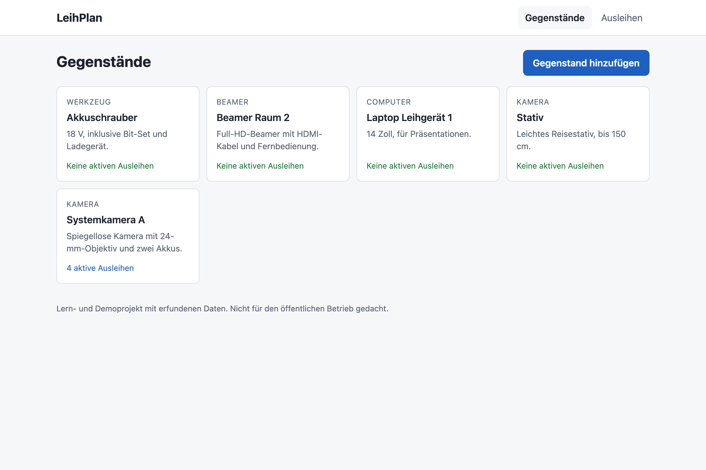
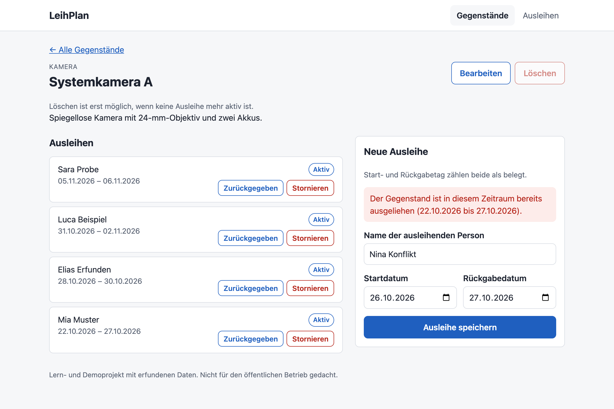
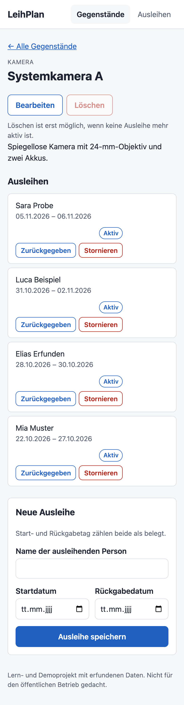

# LeihPlan

Eine kleine Webanwendung zur Verwaltung und Ausleihe von Gegenständen wie Kameras, Beamern oder Werkzeug.

LeihPlan ist ein **Lern- und Demonstrationsprojekt** für meine Bewerbung um ein IMS-Jahrespraktikum in der Applikationsentwicklung. Alle Personen und Daten sind erfunden.



## Funktionen

**Gegenstände**
- Übersicht aller Gegenstände mit Kategorie und Anzahl aktiver Ausleihen
- Detailansicht mit allen Ausleihen des Gegenstands
- Gegenstände hinzufügen, bearbeiten und löschen
- Jeder Eintrag steht für genau ein physisches Exemplar

**Ausleihen**
- Ausleihe erfassen: Gegenstand, Name der ausleihenden Person, Start- und Rückgabedatum
- Ausleihen anzeigen und nach Status filtern (aktiv, zurückgegeben, storniert)
- Ausleihen stornieren oder als zurückgegeben markieren
- Die Daten bleiben nach einem Neustart erhalten (SQLite-Datei)

**Regeln (gelten auf dem Server)**
- Pflichtfelder werden geprüft, und reine Leerzeichen gelten als leer.
- Ungültige Daten werden abgewiesen, zum Beispiel `2026-02-30` oder `10.03.2026`.
- Das Rückgabedatum darf nicht vor dem Startdatum liegen.
- **Start- und Rückgabetag zählen beide als belegt.** Eine Ausleihe vom 10. bis 12. März blockiert den 10., 11. und 12. März.
- Überschneidende Ausleihen desselben Gegenstands werden abgelehnt.
- Nur **aktive** Ausleihen blockieren. Stornierte und zurückgegebene Ausleihen blockieren nicht.
- Ein Gegenstand mit aktiven Ausleihen kann nicht gelöscht werden. Zusätzlich fragt die Oberfläche vor dem Löschen nach.

| Abgelehnte Überschneidung | Smartphone |
| --- | --- |
|  |  |

## Technik

| Teil | Technologie | Aufgabe |
| --- | --- | --- |
| Oberfläche | React 19, TypeScript, Vite 8 | Seiten, Formulare, Anzeige |
| API | Node.js 24 oder neuer, Express 5, TypeScript | Nimmt Anfragen an, prüft Regeln |
| Datenbank | SQLite über `node:sqlite` (in Node eingebaut) | Speichert die Daten in einer Datei |
| Tests | `node:test` (in Node eingebaut) | Prüft die Regeln über echte HTTP-Anfragen |

Node führt die TypeScript-Dateien des Servers direkt aus. Darum braucht es keinen eigenen Build-Schritt für den Server.

Mehr zum Aufbau steht in [docs/ARCHITEKTUR.md](docs/ARCHITEKTUR.md).

## Starten

Voraussetzung: [Node.js](https://nodejs.org/) ab Version 24 (getestet mit 26.8).

```bash
# 1. Abhängigkeiten installieren
cd server && npm install
cd ../client && npm install

# 2. Optional: erfundene Beispieldaten anlegen
cd ../server && npm run seed

# 3. API starten (Terminal 1, im Ordner server)
npm run dev

# 4. Oberfläche starten (Terminal 2, im Ordner client)
npm run dev
```

Danach öffnest du http://localhost:5173 im Browser. Die API läuft auf http://127.0.0.1:3001. Vite leitet alle Anfragen an `/api` dorthin weiter.

Die Datenbank liegt in `server/leihplan.db`. Wenn du die Datei löschst, startet die App leer.

## Tests

```bash
cd server
npm test
```

Die Tests prüfen 20 Fälle in sechs Gruppen:

1. Eine gültige Ausleihe wird gespeichert.
2. Überschneidende Ausleihen werden abgelehnt.
3. Die Datumsgrenzen gelten: Ein Start am Rückgabetag wird abgelehnt, ein Start am Tag danach ist erlaubt.
4. Ungültige Eingaben werden abgewiesen.
5. Stornierte Ausleihen blockieren nicht mehr.
6. Der Löschschutz für Gegenstände mit aktiver Ausleihe greift.

Jeder Test verwendet eine frische Datenbank im Arbeitsspeicher. Die echte Datenbank wird nicht verändert.

## Bewusste Grenzen

- Keine Anmeldung und keine Benutzerrollen. Darum hört der Server nur auf `127.0.0.1` und ist **nicht für den öffentlichen Betrieb** gedacht.
- Keine Zahlungen, E-Mails oder Benachrichtigungen.
- Keine externen APIs und keine KI-Funktion in der Anwendung.
- Keine echten Personendaten.
- Jeder Gegenstand ist genau ein Exemplar. Mengen wie «3 Stative» werden nicht unterstützt.
- Ausleihen in der Vergangenheit sind erlaubt. Es gibt keine Prüfung gegen das heutige Datum.
- Eine Ausleihe lässt sich nach dem Speichern nicht bearbeiten. Man storniert sie und erfasst sie neu.
- Keine automatischen Tests für die Oberfläche, nur für die API.

## KI-Einsatz

Dieses Projekt ist mit starker Unterstützung von **Claude** (Anthropic, in Claude Code) entstanden. Ich beschreibe den Umfang ehrlich:

- **Von mir:** Projektidee, Anforderungen, Umfang der ersten Version, bewusste Grenzen und die gewünschten Testfälle.
- **Von Claude:** Der gesamte erste Stand des Codes (Server, Datenbank, Oberfläche, Tests), diese README, die Architektur-Erklärung und die Screenshots. Claude hat auch die Technik ausgewählt (zum Beispiel `node:sqlite` statt einer zusätzlichen Bibliothek) und die Regel festgelegt, dass Start- und Rückgabetag beide als belegt zählen.
- **Geprüft:** Claude hat die Tests ausgeführt (20 von 20 bestanden), die Typprüfung laufen lassen und die App im Browser ausprobiert.

Was ich danach selbst verstanden, geändert und entschieden habe, steht in [docs/EIGENE-ARBEIT.md](docs/EIGENE-ARBEIT.md).
